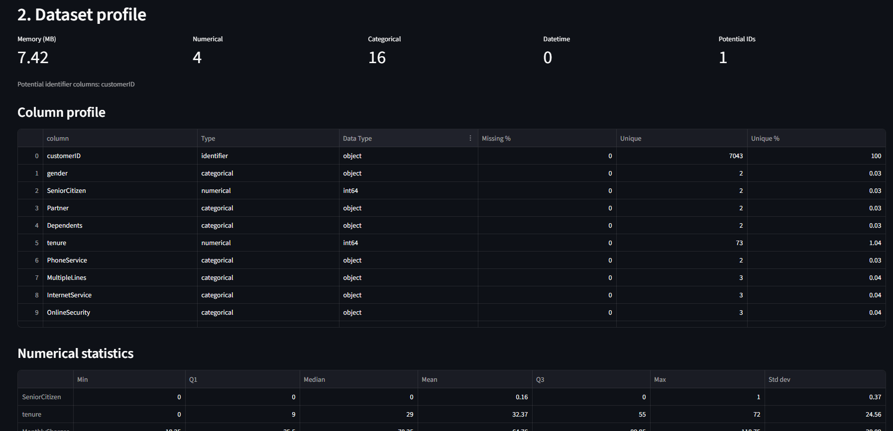
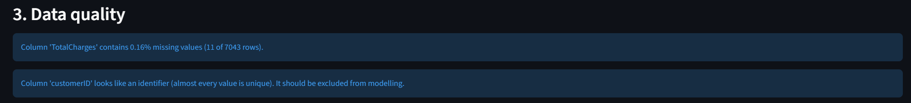
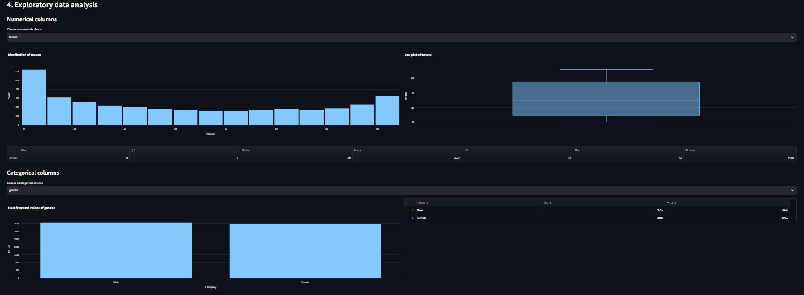
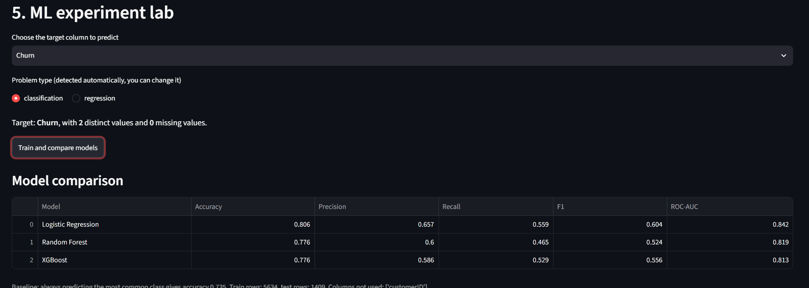

# AI Data Scientist

A Streamlit app that automates the repetitive first steps of a data-science workflow on any CSV: validation, profiling, data-quality checks, exploratory analysis and model comparison. It also has a chat-style analyst where an LLM answers questions by calling Python tools.

**Design principle:** the LLM never calculates numbers. Pandas and scikit-learn do all calculations in deterministic Python functions. The LLM only chooses which tool to call and explains the result, and every tool call and raw result is shown in the interface so answers can be checked.

## Screenshots

| Upload and profile | Data quality |
|---|---|
|  |  |

| EDA | Model comparison |
|---|---|
|  |  |


## Features

**Upload and validation**
- Rejects empty files, header-only files and unparseable files with a clear message instead of crashing
- Falls back to a second text encoding when UTF-8 fails
- Strips whitespace from column names
- Converts text columns to numbers only when every non-blank value is a valid number (blank cells become missing values)

**Dataset profiling**
- Classifies each column as numerical, categorical, datetime or potential identifier
- Per-column data type, missing count and percentage, unique count and percentage
- Min, Q1, median, mean, Q3, max and standard deviation for numerical columns, and memory usage

**Data-quality checks** (every message is built from a computed value)
- Missing values, duplicate rows, constant columns
- Outliers using the IQR rule (binary-like columns and zero-IQR columns are skipped to avoid false alarms)
- Potential identifier columns and high-cardinality categorical columns

**Exploratory data analysis**
- Histogram and box plot for numerical columns
- Frequency table and bar chart for categorical columns (top 15 values)
- Correlation heatmap and scatter plot for numerical columns

**ML experiment lab**
- Choose a target; the problem type (classification or regression) is detected automatically and can be changed, with validation of unsuitable choices
- Preprocessing pipeline: median or most-frequent imputation, standardisation, one-hot encoding; identifier and datetime columns are excluded
- Stratified 80/20 train-test split; preprocessing is fitted on the training rows only to avoid data leakage
- Classification: Logistic Regression, Random Forest, XGBoost with accuracy, precision, recall, F1 and ROC-AUC
- Regression: Linear Regression, Random Forest, XGBoost with MAE, RMSE and R²
- A baseline (majority class or training mean) is shown next to the results; no model is declared "best"

**AI data analyst**
- Five tools: dataset summary, column statistics, group comparison, correlation, outlier detection
- LangChain tool-calling loop with a round limit; tools validate their inputs and return errors instead of raising them
- The "Tools used" panel shows each tool call, its arguments and the raw result

**Tests**
- A pytest suite for the core functions, with expected values worked out by hand

## Architecture

```
                        Streamlit UI (app.py)
                                │
         ┌──────────────────────┼──────────────────────┐
         │                      │                      │
  Data and analysis          ML lab                AI analyst
  src/data, src/analysis     src/ml                src/ai
  Pandas, NumPy, Plotly      scikit-learn, XGBoost LangChain + LLM
         │                      │                      │
         └──────────────────────┴───────────┬──────────┘
                                            │
                       Deterministic Python tools (src/ai/tools.py)
```

The analyst loop:

```
question -> LLM picks a tool -> Python runs it on the real data -> result -> LLM explains it
```

## Project structure

```
AI-Data-Scientist/
├── app.py                  Streamlit UI only; no analysis logic
├── requirements.txt
├── src/
│   ├── data/loader.py          CSV loading, validation, text-to-number conversion
│   ├── analysis/
│   │   ├── profiler.py         column types, profile tables, statistics
│   │   ├── quality.py          data-quality checks
│   │   └── eda.py              chart builders
│   ├── ml/
│   │   ├── problem_type.py     classification vs regression, target checks
│   │   ├── preprocessing.py    split and preprocessing pipeline
│   │   └── trainer.py          model training and comparison
│   └── ai/
│       ├── tools.py            deterministic tools the LLM can call
│       └── analyst.py          LLM setup and the tool-calling loop
├── tests/test_core.py
├── data/                   put your CSV files here (not committed)
└── docs/screenshots/
```

## Setup

Requires Python 3.10 or newer.

```bash
git clone https://github.com/satyam-shaswat/AI_DataScientist.git
cd AI-Data-Scientist
python -m venv .venv

# Windows
.venv\Scripts\activate
# macOS / Linux
source .venv/bin/activate

pip install -r requirements.txt
```

### Configure the LLM (only needed for the AI analyst)

Create a `.env` file in the project root (it is git-ignored):

```
LLM_MODEL=google_genai:<model-name>
GOOGLE_API_KEY=your-key
```

The analyst has been tested with Google Gemini through `langchain-google-genai`. LangChain's `init_chat_model` also supports other providers, but those have not been tested here. Everything except the AI analyst works without a key.

### Run

```bash
streamlit run app.py
```

### Test

```bash
python -m pytest
```

## Example dataset

The project was developed and tested on the public **Telco Customer Churn** dataset from Kaggle. It is included in this repository. Any reasonably sized CSV can be uploaded.

## Known limitations

- Validation covers file format and column types; there is no schema or value-range validation (for example, flagging a negative age) and no file-size limit
- Datetime columns are excluded from modelling, and high-cardinality categorical columns create many one-hot columns
- No hyperparameter tuning; models use sensible defaults
- The analyst has five tools only. It cannot yet answer questions about the trained models, and there is no automatic check that its sentences match the tool output (the tool trace is shown for manual checking)
- The analyst depends on an external LLM API. On the free tier, requests are rate-limited (20 per day per model at the time of testing) and the app shows a message when the quota is used up
- Questions and tool results, not the full dataset, are sent to the LLM provider
- Single user, local use only

## Roadmap (not implemented)

SHAP model explanations, an automated insight engine, report generation, analyst tools for model results, a result validator for analyst answers, and a production architecture (API backend and database).
